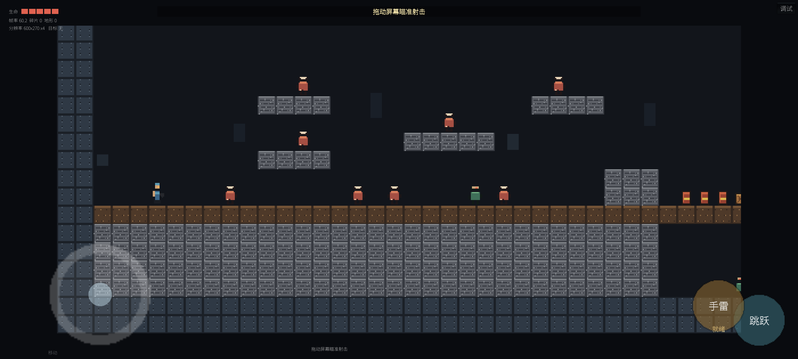

# BREAKLINE / 断线行动 — M1

原创移动横版 run-and-gun 灰盒（无复制资产/角色/关卡）。当前只做 M1，不含 M2 内容。

## 当前状态

- 引擎：Unity **2021.3.45f2**，IL2CPP / ARM64 / GLES3，内置管线。
- 目标机：**vivo iQOO Neo10（V2425A，Android 16）**，用户指定；高端机，数据不外推中端。
- 当前构建：**3 张原创 whitebox 关卡**（训练场 / 维修隧道 / 屋顶追逐），Release `5AE97988...`（20,044,462 B）；Debug `5996F005...`。
- 真机已通过：P4 200 可见碎片、P5 200 全刚体（非门槛）、压敌、自动刀零误触、中文 UI、拖拽瞄准/射击方向修复、自动手雷修复、可见瞄准轮盘、第二关结算自动进入第三关；2026-11-12 23:08 同一进程从第 1 关起点完整跑通 1→2→3，第 3 关终点横幅正常。第 1 关压敌闸门由现场调试链爆触发。
- P6：1203 构建完成 56 个 10s 压力窗口（33,463 帧，加权平均 60.211，max 16.65 ms，>33 ms 帧 0）；**不是完整 10 分钟游图**，当前关卡构建未重跑 P6。
- 判定：**Conditional / 未 Go**。纯人工完整 1→2→3（第 1 关闸门未用调试链爆）、后台恢复、跳跃/下压逐项、真人手指手感仍未签字。

详细报告：[docs/11_原创三关_2026-11-12.md](docs/11_原创三关_2026-11-12.md)。轮盘：[docs/10_可见瞄准轮盘_2026-11-12.md](docs/10_可见瞄准轮盘_2026-11-12.md)。自动手雷修复：[docs/09_自动手雷修复_2026-11-12.md](docs/09_自动手雷修复_2026-11-12.md)。历史构建：[docs/08_最终真机验收_2026-11-12.md](docs/08_最终真机验收_2026-11-12.md)。



## 操作

- 左下摇杆：水平移动；下拉 + 跳跃：下压。
- 右下 `跳跃`、`手雷`；手雷需短按约 0.08s 且不拖动，拖拽/瞄准/开火时不会误投。
- 关卡：正常启动从训练场开始，通关自动进入下一关；调试面板可切 1/2/3。
- **屏幕其余区域**：按住并拖动，出现可见瞄准轮盘，朝轮盘旋钮方向瞄准/射击；松手停止；无自动瞄准/自动射击。
- 贴墙不再卡住/慢滑；落地不再爆炸。

## 构建

```powershell
& 'E:\Unity\Hub\Editor\2021.3.45f2\Editor\Unity.exe' `
  -batchmode -quit -projectPath 'E:\BreaklineUnity' `
  -executeMethod Breakline.EditorTools.BuildScript.BuildRelease `
  -logFile 'docs\evidence\build-release.log'
```

APK 输出：`E:\BreaklineUnity\Builds\BREAKLINE_M1_RELEASE.apk`。
测试/交付路径：`E:\BreaklineDeliver\BREAKLINE_M1_DAY6_RELEASE_arm64.apk`。

## 目录

- `UnityProject/Assets/Breakline/Runtime/`：游戏运行时代码（地形、玩家、敌人、输入、HUD、性能记录等）。
- `UnityProject/Assets/Resources/Config/`：8 张 CSV 调参表，每行含 `tune_up/tune_down` 体感说明。
- `docs/`：技术方案、M1 计划、性能/验收/APK 说明、证据。
- `docs/evidence/`：真机 CSV、raw 帧、截图、日志。

## 范围边界

不含多人、剧情 CG、皮肤/内购、账号、关卡编辑器；当前没有 M2 角色/关卡。APK 使用 debug 证书，仅内测安装。
